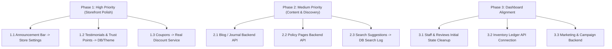

# Mock Data Audit & Migration Roadmap

This document outlines all remaining mock, static, and hardcoded data in the codebase, detailing where they are displayed in the frontend, the source files, and the recommended steps to make them fully dynamic.

---

## Summary Matrix

| Section / Feature | Type | Status | File Location | Mock Source | Priority |
| :--- | :--- | :--- | :--- | :--- | :--- |
| **Top Announcement Bar** | Storefront | ✅ **COMPLETED (Dynamic DB)** | `frontend/src/components/store/layout/StoreHeader.tsx` | Tenant DB Settings | High |
| **Homepage Testimonials** | Storefront | ✅ **COMPLETED (Dynamic DB Carousel)** | `frontend/src/components/store/landing/LandingSections.tsx` | Database Reviews API | High |
| **Homepage Trust Points** | Storefront | Hardcoded Array | `frontend/src/components/store/landing/LandingSections.tsx` | `data/content.ts` | Medium |
| **Journal / Blog Pages** | Storefront | Static Content | `frontend/src/app/(store)/journal/page.tsx` | `data/content.ts` | High |
| **Policy Pages** | Storefront | Static Content | `frontend/src/app/(store)/policies/[slug]/page.tsx` | `data/content.ts` | Medium |
| **Search Popular Searches** | Storefront | Static Array | `frontend/src/components/store/layout/SearchOverlay.tsx` | `data/content.ts` | Medium |
| **Discount Coupons** | Checkout | ✅ **COMPLETED (Dynamic Engine)** | `frontend/src/app/(store)/cart/page.tsx`, `checkout/page.tsx` | Backend Discount Engine (`/discounts/apply`) | High |
| **Product Size Guide** | Storefront | Hardcoded Table | `frontend/src/components/store/product/ProductDetailView.tsx` | `data/products.ts` | Low |
| **About Page Fallback** | Storefront | Fallback Constant | `frontend/src/app/(store)/about/page.tsx` | `DEFAULT_ABOUT` | Low |
| **FAQ Page Fallback** | Storefront | Fallback Constant | `frontend/src/app/(store)/faq/page.tsx` | `data/content.ts` | Low |
| **Admin Marketing** | Dashboard | 100% Mock | `frontend/src/app/(dashboard)/admin/marketing/page.tsx` | `data/admin.ts` | Medium |
| **Admin Billing** | Dashboard | Static Entitlements | `frontend/src/app/(dashboard)/admin/billing/page.tsx` | `data/admin.ts` | Low |
| **Admin Content Management**| Dashboard | Static Pages/Menus | `frontend/src/app/(dashboard)/admin/content/page.tsx` | `data/admin.ts` | Medium |
| **Admin Inventory Ledger** | Dashboard | Initial State Mock | `frontend/src/components/dashboard/admin/inventory/InventoryManager.tsx` | `data/admin.ts` | Medium |
| **Admin Staff & Roles** | Dashboard | Initial State Mock | `frontend/src/app/(dashboard)/admin/staff/page.tsx` | `data/admin.ts` | Medium |
| **Admin Reviews Initial** | Dashboard | ✅ **COMPLETED (Real State & CRUD)** | `frontend/src/app/(dashboard)/admin/reviews/page.tsx` | Clean server state | Medium |
| **Admin Analytics Region** | Dashboard | Initial State Mock | `frontend/src/app/(dashboard)/admin/analytics/page.tsx` | `data/analytics.ts` | Medium |

---

## 1. Storefront (Customer-Facing) Mock Data

### 1.1 Top Announcement Bar
- **Display Location:** Top header of all storefront pages.
- **Affected File:** [`frontend/src/components/store/layout/StoreHeader.tsx`](file:///d:/Orvio/multi-tenant-ecommerce/frontend/src/components/store/layout/StoreHeader.tsx#L19)
- **Current Behavior:** Imports `announcement` directly from `data/content.ts`:
  ```ts
  export const announcement = 'Free delivery inside Dhaka on orders over ৳2,500 · Easy 7-day returns';
  ```
- **Migration Plan:**
  - Connect to backend tenant store settings (`storeService.getPublicStoreInfo()` or `tenant.announcement`).
  - Render dynamically from tenant state (`storeForm.announcement` already exists in admin settings).

---

### 1.2 Homepage Testimonials & Customer Quotes
- **Display Location:** Homepage / Landing page reviews carousel/grid.
- **Affected Files:**
  - [`frontend/src/components/store/landing/useLandingModel.ts`](file:///d:/Orvio/multi-tenant-ecommerce/frontend/src/components/store/landing/useLandingModel.ts#L5)
  - [`frontend/src/components/store/home/Testimonials.tsx`](file:///d:/Orvio/multi-tenant-ecommerce/frontend/src/components/store/home/Testimonials.tsx#L2)
  - [`frontend/src/components/store/landing/LandingSections.tsx`](file:///d:/Orvio/multi-tenant-ecommerce/frontend/src/components/store/landing/LandingSections.tsx#L580)
- **Current Behavior:** Renders 3 hardcoded customer testimonials:
  - *Ayesha Siddiqua* (Gulshan, Dhaka)
  - *Tanvir Ahmed* (Chattogram)
  - *Farhana Rahman* (Sylhet)
- **Migration Plan:**
  - Fetch top-rated approved 5-star customer reviews via `reviewService.getFeaturedReviews()`, or allow store owners to curate testimonials in Admin Theme / Content settings.

---

### 1.3 Homepage Trust Points (Value Propositions)
- **Display Location:** Homepage trust badge strip.
- **Affected Files:**
  - [`frontend/src/components/store/landing/LandingSections.tsx`](file:///d:/Orvio/multi-tenant-ecommerce/frontend/src/components/store/landing/LandingSections.tsx#L541)
  - [`frontend/src/components/store/home/TrustPoints.tsx`](file:///d:/Orvio/multi-tenant-ecommerce/frontend/src/components/store/home/TrustPoints.tsx#L2)
- **Current Behavior:** Hardcoded value propositions in `data/content.ts`:
  - *"Made by artisans"*
  - *"7-day easy returns"*
  - *"Pay your way"*
  - *"Delivery in 64 districts"*
- **Migration Plan:**
  - Move into tenant theme configuration / customizable store perks in Admin Theme Settings.

---

### 1.4 Journal / Blog (`/journal` & `/journal/[slug]`)
- **Display Location:** Storefront blog listing and single post reader.
- **Affected Files:**
  - [`frontend/src/app/(store)/journal/page.tsx`](file:///d:/Orvio/multi-tenant-ecommerce/frontend/src/app/(store)/journal/page.tsx#L5)
  - [`frontend/src/app/(store)/journal/[slug]/page.tsx`](file:///d:/Orvio/multi-tenant-ecommerce/frontend/src/app/(store)/journal/[slug]/page.tsx#L6)
- **Current Behavior:** Pure static array `blogPosts` from `data/content.ts` with 4 articles:
  - *Three weeks on a pit loom: the story of a jamdani*
  - *The Eid 2026 styling guide*
  - *How to care for linen in monsoon season*
  - *Meet the cobblers of Bhairab*
- **Migration Plan:**
  - Implement a `BlogPost` model in Prisma / Backend.
  - Expose `GET /public/posts` and `GET /public/posts/:slug`.
  - Connect Admin Content (`/admin/content`) blog tab to CRUD operations in backend.

---

### 1.5 Storefront Policies (`/policies/shipping`, `/privacy`, `/terms`, `/cookies`)
- **Display Location:** Policy routes linked in the footer.
- **Affected File:** [`frontend/src/app/(store)/policies/[slug]/page.tsx`](file:///d:/Orvio/multi-tenant-ecommerce/frontend/src/app/(store)/policies/[slug]/page.tsx#L5)
- **Current Behavior:**
  - Only `returns` fetches from `pageService.getPublicReturnsPage()`.
  - `shipping`, `privacy`, `terms`, and `cookies` fall back directly to static hardcoded text in `data/content.ts` (which mentions "Tanti", Dhaka delivery rates, Pathao/Steadfast, etc.).
- **Migration Plan:**
  - Implement backend page/policy endpoints in `pageService` (`GET /public/pages/:slug`) and store customizable policy markdown/HTML per tenant.

---

### 1.6 Search Overlay Popular Searches
- **Display Location:** Quick search drawer modal (`SearchOverlay`).
- **Affected File:** [`frontend/src/components/store/layout/SearchOverlay.tsx`](file:///d:/Orvio/multi-tenant-ecommerce/frontend/src/components/store/layout/SearchOverlay.tsx#L9)
- **Current Behavior:** Hardcoded list: `['Panjabi', 'Jamdani saree', 'Linen', 'Sneakers', 'Kurta set', 'Eid']`.
- **Migration Plan:**
  - Fetch dynamic popular searches from `analyticsService.getTopSearches()` which already queries database search logs.

---

### 1.7 Coupon Codes & Discounts
- **Display Location:** Cart & Checkout coupon code validator.
- **Affected Files:**
  - [`frontend/src/utils/pricing.ts`](file:///d:/Orvio/multi-tenant-ecommerce/frontend/src/utils/pricing.ts#L1)
  - [`frontend/src/data/shipping.ts`](file:///d:/Orvio/multi-tenant-ecommerce/frontend/src/data/shipping.ts#L858)
- **Current Behavior:** `findCoupon(code)` validates against a local array of 3 hardcoded coupons:
  - `TANTI10` (10% off)
  - `EID500` (৳500 off orders over ৳3,000)
  - `FREESHIP` (Free delivery)
- **Migration Plan:**
  - Connect coupon validation to `discountService` (`POST /customer/coupons/validate` or `GET /customer/discounts/:code`).

---

### 1.8 Product Size Guide & Delivery Rates
- **Display Location:** Product detail modal & page.
- **Affected File:** [`frontend/src/components/store/product/ProductDetailView.tsx`](file:///d:/Orvio/multi-tenant-ecommerce/frontend/src/components/store/product/ProductDetailView.tsx#L18-L19)
- **Current Behavior:**
  - `sizeGuide` is hardcoded in `data/products.ts`.
  - Delivery rates and districts are hardcoded in `data/shipping.ts`.
- **Migration Plan:**
  - Store size guides per category in the database or product attribute metadata.
  - Pull shipping zones dynamically from tenant shipping configuration.

---

### 1.9 About Us & FAQ Page Fallbacks
- **Display Locations:** `/about` and `/faq`.
- **Affected Files:**
  - [`frontend/src/app/(store)/about/page.tsx`](file:///d:/Orvio/multi-tenant-ecommerce/frontend/src/app/(store)/about/page.tsx#L8)
  - [`frontend/src/app/(store)/faq/page.tsx`](file:///d:/Orvio/multi-tenant-ecommerce/frontend/src/app/(store)/faq/page.tsx#L6)
- **Current Behavior:** Both pages have backend API calls (`pageService.getPublicPage('about')` and `faqService.getCustomerFaqs()`). However, if no records exist in the database, they fall back to hardcoded mock data for the "Tanti" brand.
- **Migration Plan:**
  - Display an empty state or tenant placeholder if no database record exists, or seed default records during tenant provisioning.

---

## 2. Admin Dashboard Mock Data

### 2.1 Marketing & Campaigns (`/admin/marketing`)
- **Affected File:** [`frontend/src/app/(dashboard)/admin/marketing/page.tsx`](file:///d:/Orvio/multi-tenant-ecommerce/frontend/src/app/(dashboard)/admin/marketing/page.tsx#L6)
- **Current Behavior:**
  - 100% Mock. Hardcoded KPI cards: `Attributed revenue · 30d: ৳1,658,000`, `Orders influenced: 1,420`, etc.
  - Campaigns and automations are loaded from `data/admin.ts`.
- **Migration Plan:**
  - Build backend schema for marketing campaigns and automated triggers (abandoned cart recovery, welcome discount).

---

### 2.2 Billing & Subscription (`/admin/billing`)
- **Affected File:** [`frontend/src/app/(dashboard)/admin/billing/page.tsx`](file:///d:/Orvio/multi-tenant-ecommerce/frontend/src/app/(dashboard)/admin/billing/page.tsx#L5)
- **Current Behavior:** Displays static feature limits (`entitlements`) and pricing matrices from `data/admin.ts`.
- **Migration Plan:**
  - Connect to platform-level tenant subscription API.

---

### 2.3 Content Management (`/admin/content`)
- **Affected File:** [`frontend/src/app/(dashboard)/admin/content/page.tsx`](file:///d:/Orvio/multi-tenant-ecommerce/frontend/src/app/(dashboard)/admin/content/page.tsx#L6)
- **Current Behavior:**
  - "Pages" tab lists static `cmsPages` from `data/admin.ts`.
  - "Blog" tab lists static `blogPosts` from `data/content.ts`.
  - "Navigation" tab lists static `menus` from `data/admin.ts`.
- **Migration Plan:**
  - Connect CMS pages, navigation menus, and blog posts to backend Prisma models.

---

### 2.4 Inventory Ledger (`/admin/inventory`)
- **Affected File:** [`frontend/src/components/dashboard/admin/inventory/InventoryManager.tsx`](file:///d:/Orvio/multi-tenant-ecommerce/frontend/src/components/dashboard/admin/inventory/InventoryManager.tsx#L7)
- **Current Behavior:**
  - Stock levels are real (from `inventoryService`).
  - However, the "Ledger / Stock Movements" tab initializes with `stockMovements` mock data from `data/admin.ts`.
- **Migration Plan:**
  - Connect ledger tab to `inventoryService.getStockMovements()` to fetch real audit trail logs from the database.

---

### 2.5 Staff & Role Management (`/admin/staff`)
- **Affected File:** [`frontend/src/app/(dashboard)/admin/staff/page.tsx`](file:///d:/Orvio/multi-tenant-ecommerce/frontend/src/app/(dashboard)/admin/staff/page.tsx#L7)
- **Current Behavior:**
  - Initializes state with `seedStaff` and `seedRoles` from `data/admin.ts` ("Nafis Fuad", "Tasnim Ara", etc.).
- **Migration Plan:**
  - Initialize with empty array and fetch strictly from `staffService.getStaffList()` and `staffService.getRoles()`.

---

### 2.6 Reviews Moderation (`/admin/reviews`)
- **Affected File:** [`frontend/src/app/(dashboard)/admin/reviews/page.tsx`](file:///d:/Orvio/multi-tenant-ecommerce/frontend/src/app/(dashboard)/admin/reviews/page.tsx#L2)
- **Current Behavior:**
  - Passes `initialReviews` from `data/reviews.ts` to `ReviewsManager`.
- **Migration Plan:**
  - Remove `initialReviews` prop so it initializes cleanly with an empty list or loading skeleton while `reviewService.getOwnerReviews()` executes.

---

## 3. What is ALREADY REAL & Dynamic (Production-Ready)

The core e-commerce engine is already completely hooked into real PostgreSQL / Prisma APIs:

1. **Products (`/shop`, Homepage Product Grid, Product Details):**
   - Fetched dynamically from database via `productService.getProducts()`.
   - `useStoreCatalog.ts` initializes with strictly empty state (`[]`) and has zero mock product fallbacks.
2. **Categories & Collections:**
   - Real categories and collections fetched from `categoryService` and `collectionService`.
3. **Cart & Checkout Engine:**
   - Real cart management, variant stock checks, and checkout flow.
4. **Orders & Customer Portal:**
   - Real order creation (`orderService.createOrder()`), database order histories, and timeline tracking.
5. **Customer Authentication:**
   - Real JWT auth, customer profiles, address book (`address-service.ts`), and password management.
6. **Live Analytics KPIs:**
   - Real-time polling from `/owner/analytics/overview` calculating gross sales, net sales, orders, and customer counts.

---

## 4. Suggested Implementation Phases



1. **Phase 1 (Storefront Polish) - [COMPLETED]:**
   - ✅ **Announcement Bar**: Dynamic from Tenant DB store settings (`tenant.announcement`, `tenant.announcementEnabled`).
   - ✅ **Reviews & Testimonials Carousel**:
     - Customer reviews fetched dynamically from database (`GET /customer/reviews` with pagination `limit: 15`).
     - Responsive multi-card auto-playing carousel with hover pause and click navigation.
     - Carousel slide change arrows (`<` and `>`) placed at the top-right of the header beside the title.
     - Dynamic star ratings and reviewer details.
     - Supports both `cards` and `quotes` design styles from `landing-config.ts`.
     - Admin dashboard allows manual creation (`CreateReviewModal`), hide/show toggle (`PUBLISHED`/`HIDDEN`), review customization, and deletion.
   - ✅ **Coupons & Discounts**: Connected Cart and Checkout directly to backend discount engine (`POST /discounts/apply`).

2. **Phase 2 (Content & Policies):**
   - Create database models for Blog Posts and Policies.
   - Replace static `/journal` and `/policies/*` routes with dynamic database content.

3. **Phase 3 (Dashboard Cleanup):**
   - Remove mock initial states in Admin Staff, Reviews, and Inventory Ledger.
   - Build out backend endpoints for Marketing and Campaign automation.
